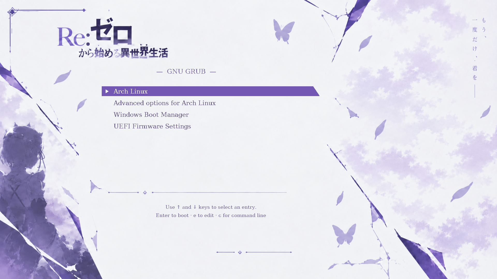

# Re:Zero Lavender — GRUB theme

A real GRUB 2 boot menu based on the supplied Re:Zero reference: pale lavender
artwork, butterflies, fractured glass, serif lettering and a purple selection bar
with a moving white arrow.



The screenshot is from **GRUB in a virtual machine**. Installed menus use your
existing Arch, Windows, kernel and recovery entries. The theme does not add or
rename operating systems. Hyprland's Lua/configuration format has no effect on
this theme: GRUB runs before Linux and Hyprland.

## Install on Arch Linux — step by step

These steps are for a computer that **already boots through GRUB**. Having
Hyprland does not determine the bootloader. If your friend uses systemd-boot,
Limine or rEFInd, this theme cannot be applied to it.

### 1. Check the existing GRUB setup and install the tools

```bash
ls /etc/default/grub /boot/grub/grub.cfg
sudo pacman -Syu --needed git python grub
```

Both files must exist. If the first command reports a missing file, stop here
and check which bootloader is actually in use. Installing the `grub` package
alone does not switch bootloaders. This project does not run `grub-install` or
change firmware boot entries.

### 2. Download the complete theme

Run this in the folder where you keep projects:

```bash
git clone https://github.com/MrTr4p/rezero-grub-theme.git
cd rezero-grub-theme
```

Fonts and images are already included. Installation needs Bash, Python 3 and the
GRUB tools; it does not need Pillow, Node, Hyprland plugins or an image service.

### 3. Preview the planned changes

```bash
./install.sh --dry-run --profile 1080p --timeout 10
```

This prints the destination, settings and timeout without changing any files.
Pick the profile that matches the monitor:

| Screen | Profile | Install command |
| --- | --- | --- |
| 1920×1080 or 1600×900 | `1080p` | `sudo ./install.sh --profile 1080p --timeout 10` |
| 2560×1440 | `1440p` | `sudo ./install.sh --profile 1440p --timeout 10` |
| 1366×768, 1280×720 or 1024×768 | `compact` | `sudo ./install.sh --profile compact --timeout 10` |

The artwork is scaled to fill the display; non-16:9 screens stretch the artwork.
Firmware must support the requested video mode. Each profile includes fallback
resolutions, but the text size stays fixed; use `compact` for smaller displays.

### 4. Install

For a typical Full HD screen:

```bash
sudo ./install.sh --profile 1080p --timeout 10
```

Wait for `Install complete` and `GRUB configuration validated and updated`.
The installer copies the theme into `/boot/grub/themes/rezero-lavender`, appends
a clearly marked block to `/etc/default/grub`, enables the graphical menu, and
generates a temporary configuration with your system's `grub-mkconfig`.
It validates that configuration with `grub-script-check` and checks for menu
entries and the theme before replacing `/boot/grub/grub.cfg`.
**You do not need to run `grub-mkconfig` separately.**

Each attempt saves the previous defaults, generated config and existing theme in
`/var/lib/rezero-grub-theme/backup-*`. A detected installation failure restores
the previous files. Existing settings such as kernel parameters, saved defaults
and OS detection settings are retained. The timeout is 10 seconds unless changed
with `--timeout` (1–300 seconds).

### 5. Verify before rebooting

```bash
sudo grub-script-check /boot/grub/grub.cfg
sudo test -f /boot/grub/themes/rezero-lavender/theme.txt && echo "Theme installed"
sudo grep -F 'themes/rezero-lavender/theme.txt' /boot/grub/grub.cfg
sudo grep -E '^[[:space:]]*(menuentry|submenu) ' /boot/grub/grub.cfg
```

The first command succeeds silently. The next two should show `Theme installed`
and a `set theme=...` line. The last lists the boot entries generated for your
machine; confirm that your normal Linux entry is present.

Then reboot when convenient:

```bash
systemctl reboot
```

Use **↑/↓** to move, **Enter** to boot, **e** to edit and **c** for the command
line. Pressing a key cancels the countdown. The displayed timeout is managed by
GRUB and disappears once cancelled.

## Change size, update, or uninstall

Install another profile at any time:

```bash
sudo ./install.sh --profile compact --timeout 15
```

To update from this repository:

```bash
git pull --ff-only
sudo ./install.sh --profile 1080p --timeout 10
```

To remove the theme and regenerate GRUB with the previous settings:

```bash
sudo ./uninstall.sh
```

Uninstall restores the original defaults exactly if they have not been edited
since installation. If you edited them, it removes only the managed block and
keeps your edits. Reinstalling keeps one managed block. Backups remain available
after uninstall.

## Troubleshooting

- **Conflicting settings in `/etc/default/grub.d/*.cfg`:** a distribution or
  customization tool is overriding the same settings. The installer stops before
  changing anything. Remove the conflicting `GRUB_THEME`, `GRUB_GFXMODE`,
  `GRUB_TIMEOUT`, `GRUB_TIMEOUT_STYLE`, `GRUB_TERMINAL` or
  `GRUB_TERMINAL_OUTPUT` assignments from that drop-in, then retry.
- **The menu does not appear:** first confirm the computer is booting GRUB.
  This project cannot theme systemd-boot or a firmware boot selector.
- **Text is too large or clipped:** reinstall with `--profile compact`.
  Longer entry lists scroll normally.
- **Windows is absent:** the theme uses the existing generated entries and does
  not enable OS probing. Check your distribution's GRUB dual-boot setup.
- **An error occurs during install:** keep the complete terminal output. The
  previous configuration is restored on detected errors; fix the reported cause
  before retrying.
- **A firmware-specific graphics issue appears after reboot:** boot Linux using
  GRUB's console/editor if needed, then run `sudo ./uninstall.sh`. If Linux cannot
  be reached, use an Arch live USB, mount the installation, `arch-chroot` into it,
  and follow [the manual recovery steps](docs/RECOVERY.md).

## Other distributions and manual installation

The installer also recognizes `/boot/grub2/grub.cfg` and `grub2-mkconfig`, but the
primary tested installation path is Arch Linux with GRUB. Ubuntu/Debian GRUB
rendering is covered by the automated VM workflow. Fedora-specific paths and
custom or symlinked boot layouts require manual configuration.

For a custom GRUB setup, copy `theme/` to a location readable by GRUB, choose one
of `theme-1080p.txt`, `theme-1440p.txt` or `theme-compact.txt` as `theme.txt`, then
set the following in your GRUB defaults:

```sh
GRUB_THEME="/boot/grub/themes/rezero-lavender/theme.txt"
GRUB_GFXMODE="1920x1080,auto"
GRUB_TIMEOUT_STYLE=menu
GRUB_TIMEOUT=10
GRUB_TERMINAL=""
GRUB_TERMINAL_OUTPUT=gfxterm
```

Keep your previous configuration and regenerate using the correct command/path
for your distribution. All `.pf2` files must stay beside `theme.txt`; standard
GRUB `00_header` loads them automatically.

## Testing and development

See [the test report](docs/TESTING.md) for the exact checks, screenshots and
limitations. The isolated tests do not change the host bootloader.

```bash
python3 -m unittest discover -s tests -v
bash -n install.sh uninstall.sh
```

To rebuild deterministic assets on Arch:

```bash
sudo pacman -S --needed grub python-pillow ttf-dejavu
python3 scripts/build.py
```

To run the real GRUB virtual-machine tests on Arch:

```bash
sudo pacman -S --needed qemu-system-x86 edk2-ovmf libisoburn mtools python-pillow
python3 scripts/test_vm.py --firmware uefi
python3 scripts/test_vm.py --firmware bios
python3 scripts/test_vm.py --resolution 1024x768 --profile compact
python3 scripts/test_vm.py --resolution 2560x1440 --profile 1440p
python3 scripts/test_vm.py --autoboot
```

These use software emulation by default; add `--accel kvm` where available.
Screenshots and logs are saved under `build/`. The GitHub Actions workflow runs
the same VM matrix and uploads screenshots and logs.

Code and configuration are MIT licensed. Artwork and font terms are documented
separately in [CREDITS.md](CREDITS.md).
